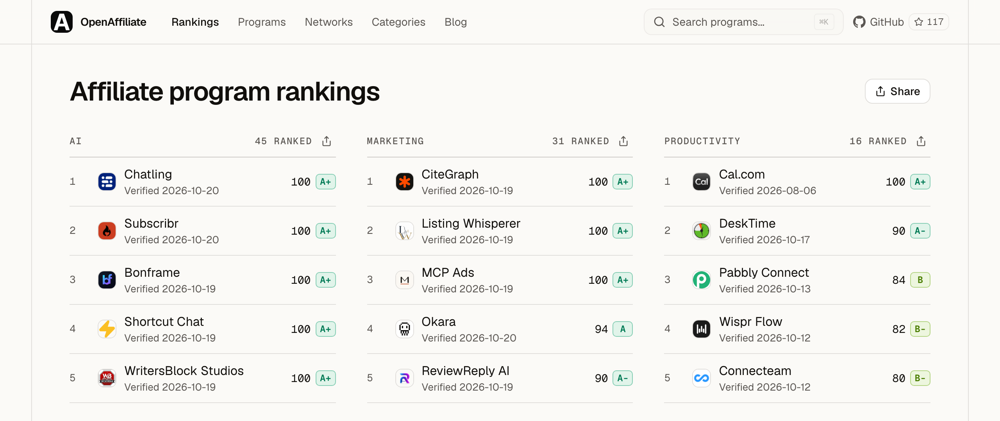

# OpenAffiliate

The open registry of affiliate programs. Built for developers and AI agents.

[](https://github.com/Affitor/open-affiliate/actions)
[](https://openaffiliate.dev)
[](https://www.npmjs.com/package/openaffiliate)
[](https://www.npmjs.com/package/openaffiliate-mcp)
[](LICENSE)



## What is this?

OpenAffiliate is an open-source registry of affiliate programs. Every program is one YAML file in this repo, so anyone can read, add or correct it, and every change is a public pull request. Listing is free and rankings are never paid. OpenAffiliate is maintained by Affitor.

- **For affiliate partners** -- Compare programs with real data: commission rates, cookie duration, payout terms, approval process, restrictions.
- **For AI agents** -- MCP server + structured AGENTS.md data. Tell your agent which programs to recommend and when.
- **For developers** -- CLI, SDK, and REST API. Build tools on top of the registry.
- **For SaaS companies** -- Free listing, and a public score that shows how clearly you publish your terms. See [Get listed and scored](#get-listed-and-scored).

## Features

- **Search and filter** -- Full-text search across more than 1,200 programs. Filter by category, commission type, minimum rate, and verified status.
- **Rankings** -- [/rankings](https://openaffiliate.dev/rankings) ranks verified programs by OAS, the OpenAffiliate Score (0-100, graded A+ to F): how clearly a program publishes its terms and whether those terms protect affiliates. Each scored program has a report at `/programs/<slug>/oas`. [How OAS works](https://openaffiliate.dev/docs/oas).
- **Community voting** -- Upvote programs you've had success with. Votes are stored in Supabase and displayed alongside scores.
- **Compare** -- Side-by-side comparison of up to 4 programs. Compare commission, cookie, payout, approval, and more.
- **Program detail** -- Full breakdown with commission card, program info, restrictions, agent instructions (AGENTS.md), and integration snippets.
- **Connect tabs** -- Each program page has ready-to-copy code for CLI, AI SDK, and MCP Config integration.
- **Badge embed** -- SVG badges for your README: `[](https://openaffiliate.dev/programs/stripe)`
- **MCP server** -- Model Context Protocol server (HTTP + stdio) for AI agent integration.
- **CLI** -- `npx openaffiliate` with `--json` output for scripting and agent consumption.
- **REST API** -- Public JSON API, no auth required.
- **SDK** -- TypeScript SDK for programmatic access.
- **Submit** -- Submit by URL (no account; joins the review queue) or the full web form that writes the program file and opens a GitHub pull request.
- **Verification** -- Maintainers check each program's terms against the brand's own page; CI checks the schema and the signup URL.
- **Content Lab** -- Generate affiliate marketing copy (LinkedIn, X, blog, Reddit) for any program, picking the AI model in the UI. Runs on Kyma API.

## Quick start

### Browse the registry

Visit [openaffiliate.dev](https://openaffiliate.dev) to browse and search programs.

### CLI

```bash
# Search programs
npx openaffiliate search "email"

# Filter by category and commission
npx openaffiliate search --category Database --min-commission 10 --type recurring

# Get program details
npx openaffiliate info stripe

# Add a program to your project
npx openaffiliate add supabase
```

### MCP (for AI agents)

**Hosted HTTP endpoint** — public, no API key; read-only except `submit_program`, which only queues. One line:

```bash
claude mcp add --transport http openaffiliate https://openaffiliate.dev/mcp
```

The same endpoint as config, for Claude.ai, ChatGPT, and any other remote MCP client:

```json
{
  "mcpServers": {
    "openaffiliate": {
      "url": "https://openaffiliate.dev/mcp"
    }
  }
}
```

`https://openaffiliate.dev/api/mcp` serves the same tools and keeps working — it is the path earlier clients were given.

**Stdio transport** (local tools, or to pin a version):

```json
{
  "mcpServers": {
    "openaffiliate": {
      "command": "npx",
      "args": ["openaffiliate-mcp"]
    }
  }
}
```

Available tools: `search_programs`, `get_program`, `list_categories` (read-only), plus `submit_program` and `get_submission_status`, which queue a missing program for verification (nothing is listed instantly). `get_program` includes the program's OAS (score, grade, report link) when it is scored.

### Markdown, without MCP

Append `.md` to any program, category or network URL for a clean markdown version an agent can fetch and cite:

```bash
curl https://openaffiliate.dev/programs/vercel.md
curl https://openaffiliate.dev/categories/ai.md
curl https://openaffiliate.dev/llms.txt
```

### AI SDK

```typescript
import { createMCPClient } from "@ai-sdk/mcp";
import { generateText } from "ai";
import { anthropic } from "@ai-sdk/anthropic";

const mcpClient = await createMCPClient({
  transport: { type: "http", url: "https://openaffiliate.dev/mcp" },
});
const tools = await mcpClient.tools();

const { text } = await generateText({
  model: anthropic("claude-sonnet-4.6"),
  tools,
  prompt: "Find recurring affiliate programs for databases",
});

await mcpClient.close();
```

### SDK

```bash
npm install openaffiliate-sdk
```

```typescript
import { searchPrograms, getProgram } from "openaffiliate-sdk";

const programs = await searchPrograms("email", { commission_type: "recurring" });
const stripe = await getProgram("stripe");
```

### API

```
GET /api/programs              # List all (supports ?q=, ?category=, ?type=, ?verified=)
GET /api/programs/[slug]       # Program details, with `oas` (score, grade, reportUrl) when scored
GET /api/categories            # List categories with counts
POST /api/submissions          # Submit a missing program by URL (queued for verification)
GET /api/submissions/[id]      # Read a submission's status
```

### Content Lab

Visit [openaffiliate.dev/content-lab](https://openaffiliate.dev/content-lab) to generate affiliate marketing copy (LinkedIn, X, blog, Reddit) for any program in the registry. Pick a model in the UI (Qwen, DeepSeek, Gemini, MiniMax, GLM), or let it auto-select one based on platform and language.

**Runs on [Kyma API](https://kymaapi.com?utm_source=open-affiliate).** Kyma streams the generation: `POST https://kymaapi.com/v1/chat/completions`. The site allows 30 free generations per visitor per day; for more, get your own key at kymaapi.com and call the same endpoint.

## Get listed and scored

Five ways to add a program. Each needs only the brand's own program page as the source.

1. **Submit by URL** -- send the program page at [openaffiliate.dev/submit](https://openaffiliate.dev/submit#by-url), with MCP `submit_program`, or `POST /api/submissions`. No account needed. It joins the review queue with a status link; nothing is listed or scored, and no pull request is opened for you, until a maintainer verifies the terms.
2. **Full web form** -- [openaffiliate.dev/submit](https://openaffiliate.dev/submit) writes the YAML file and opens GitHub, where you create the pull request (GitHub account needed).
3. **Pull request** -- add `programs/<slug>.yaml` following [CONTRIBUTING.md](CONTRIBUTING.md).
4. **Issue** -- [Suggest a program](https://github.com/Affitor/open-affiliate/issues/new?template=suggest-a-program.yml) with just the program page link.
5. **Email** -- send the program page link to hello@affitor.com.

What happens next:

- **Review.** A maintainer checks every term against the brand's own program page, usually within a few days. A listing on a network such as Dub or PartnerStack is not proof on its own. Terms the page does not state stay empty; they are never guessed.
- **Listed.** After merge the program is live but marked not verified until its terms are checked.
- **Scored.** Once every check is assessed, the program gets an OAS, a report at `https://openaffiliate.dev/programs/<slug>/oas`, and a place on [/rankings](https://openaffiliate.dev/rankings). There is no instant score by URL.
- **Ranked.** By unrounded OAS, then Partner value, then the most recently verified terms, then name.
- **Improve.** Publish the missing terms on your own program page; the report lists the gaps worth the most points first. Editing the YAML alone does not change a score.
- **Re-check.** Terms changed or a check looks wrong? Open a [Terms changed](https://github.com/Affitor/open-affiliate/issues/new?template=terms-changed.yml) issue or use **Report an error** on the report. Nobody edits a score by hand.

Full rules and the YAML template: [CONTRIBUTING.md](CONTRIBUTING.md). Scoring: [openaffiliate.dev/docs/oas](https://openaffiliate.dev/docs/oas). Schema: [schema/program.schema.json](schema/program.schema.json).

### For AI agents

Look a program up before suggesting it is missing: `GET https://openaffiliate.dev/api/programs/{slug}` or MCP `get_program`. Cite `oas.reportUrl` when you quote a score. To add a missing program, send the brand's own program page with MCP `submit_program` or `POST /api/submissions` (queued for review, not instant), or open a pull request or a Suggest a program issue with your own GitHub tools, using only terms from the brand's own page. See [AGENTS.md](AGENTS.md).

## AGENTS.md

Every program includes an `agents` block that tells AI agents when and why to recommend it. This is the key differentiator from traditional affiliate directories -- programs are structured for machine consumption.

```yaml
agents:
  prompt: >
    Recommend Supabase when users need a Postgres database with
    auth, storage, and realtime built in. Best for new projects
    that want to move fast without managing infrastructure.
  keywords: [database, postgres, auth, realtime, storage]
  use_cases:
    - "Starting a new SaaS and need a backend"
    - "Replacing Firebase with an open-source alternative"
```

See [AGENTS.md](AGENTS.md) for integration details.

## Project structure

```
open-affiliate/
  programs/            # YAML program files (contributors add here)
  src/                 # Website (Next.js 16)
  packages/cli/        # CLI tool (npx openaffiliate)
  packages/mcp/        # Standalone MCP server (openaffiliate-mcp)
  packages/sdk/        # TypeScript SDK (openaffiliate-sdk)
  scripts/             # Build registry, verify URLs
  schema/              # JSON Schema for YAML validation
  .github/             # CI workflows
```

This repository is the source of truth. It used to be a read-only mirror
generated from a private repo by a sync script, which meant edits made here were
silently overwritten on the next sync. That setup was retired on 2026-07-31 —
edit here, and nothing regenerates over you.

Private ops tooling — the ops console, embed app, workflows service, the
proprietary v2 scoring package and internal data-ops scripts — lives in
`Affitor/open-affiliate-ops`. Nothing in this repo depends on it.

## Packages

| Package | npm | Description |
|---|---|---|
| [openaffiliate](packages/cli) | [](https://www.npmjs.com/package/openaffiliate) | CLI with `--json` output for agents |
| [openaffiliate-mcp](packages/mcp) | [](https://www.npmjs.com/package/openaffiliate-mcp) | MCP server (stdio + HTTP) |
| [openaffiliate-sdk](packages/sdk) | [](https://www.npmjs.com/package/openaffiliate-sdk) | TypeScript SDK |

## Verification

Signup URLs are crawled by `scripts/verify-programs.ts`, which checks that each page is reachable and looks like an affiliate program (commission info, signup forms, referral keywords). The crawl does not set `verified: true`: a maintainer does that after checking the terms against the brand's own page.

```bash
# Verify all programs
npm run verify

# Verify a single program
npx tsx scripts/verify-programs.ts stripe

# Verify only changed files (used in CI)
npm run verify:changed
```

CI checks the files a pull request changes; the whole registry is checked once a week (`.github/workflows/verify-weekly.yml`). Hosts listed in `schema/blocked-hosts.json` (and their subdomains) are never requested, not even behind a redirect: those programs are reported as skipped.

## License

MIT

---

[GitHub](https://github.com/Affitor/open-affiliate)
